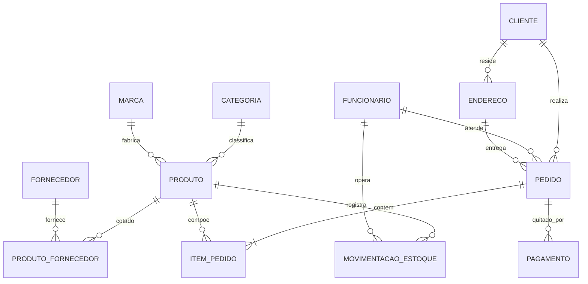

# GLF – Sistema de Gestão de Loja de Ferramentas


> Projeto de modelagem e implementação de banco de dados relacional para gestão integral de loja de ferramentas, materiais de construção e ferragens. Implementado em **MySQL 8.0** com regras de negócio blindadas no SGBD via **Triggers**, **Stored Procedures** e **Functions**, orquestrado via **Docker Compose**.

---

## Sumário
1. [Sobre o Projeto](#-sobre-o-projeto)
2. [Problema de Negócio e Solução](#-problema-de-negócio-e-solução)
3. [Como Executar o Projeto](#-como-executar-o-projeto)
4. [Diagramas de Banco de Dados](#-diagramas-de-banco-de-dados)
   - [Diagrama de Entidade e Relacionamento (DER Conceitual)](#41-diagrama-de-entidade-e-relacionamento-der-conceitual)
   - [Modelo Lógico / Físico Relacional](#42-modelo-lógico--físico-relacional)
5. [Dicionário de Dados (12 Tabelas)](#-dicionário-de-dados)
6. [Regras de Negócio no SGBD](#-regras-de-negócio-no-sgbd)
   - [User-Defined Functions (UDFs)](#61-user-defined-functions-udfs)
   - [Stored Procedures](#62-stored-procedures)
   - [Triggers](#63-triggers)
7. [Roteiro de Demonstração e Validação](#-roteiro-de-demonstração-e-validação)
8. [Estrutura de Arquivos](#-estrutura-de-arquivos)
9. [Autor e Informações Acadêmicas](#-autor-e-informações-acadêmicas)

---

## 📌 Sobre o Projeto

O **GLF (Gestão de Loja de Ferramentas)** foi desenvolvido como projeto prático da disciplina de **Tópicos Avançados em Banco de Dados (TABD)**. O objetivo foi projetar um banco de dados relacional robusto, com integridade referencial estrita e total encapsulamento da lógica de negócio na camada de persistência.

### Princípio da Soberania do Banco de Dados
Diferente de sistemas que delegam cálculos e validações unicamente ao backend (Node, Python, Java), no GLF as regras mais sensíveis residem **dentro do próprio SGBD**:
* Nenhum cliente (seja um app web, mobile, PDV ou acesso direto via DBeaver) consegue vender produtos sem estoque ou adulterar pedidos fechados.
* Totais de pedidos, cálculos de margem de lucro e baixas fiscais são disparados automaticamente pelo motor relacional.

---

## 🎯 Problema de Negócio e Solução

Lojas de ferramentas operam com alto volume de itens (SKUs), múltiplos fornecedores por peça com cotações concorrentes e fluxo de caixa com múltiplos pagamentos parciais (PIX + Cartão).

| Desafio Operacional | Solução no GLF (SGBD) |
|---|---|
| **Venda sem estoque físico** | Trigger `trg_movimentacao_bi` impede saída maior que o saldo em loja com `SIGNAL SQLSTATE '45000'`. |
| **Cotação de fornecedores dispersa** | Tabela associativa `produto_fornecedor` guarda cotações e a procedure `sp_relatorio_estoque_baixo` elege automaticamente o menor custo de reposição. |
| **Divergência de valores no carrinho** | Trigger `trg_item_pedido_ai/au/ad` recalcula o total do pedido dinamicamente a cada inclusão, edição ou exclusão de item. |
| **Baixa indevida de estoque em vendas não pagas** | Procedure `sp_registrar_pagamento` e Trigger `trg_pedido_au` só efetuam a baixa física quando o valor acumulado quita 100% da compra. |
| **Cancelamento de compra sem devolução de mercadoria** | Trigger `trg_pedido_au` gera entrada automática de estorno se o pedido for cancelado. |

---

## 🚀 Como Executar o Projeto

O projeto conta com ambiente completo e reprodutível via **Docker Compose**. O script de estrutura e carga inicial (`GLF - 01`) é executado automaticamente na inicialização do container.

### 1. Pré-requisitos
* [Docker Desktop](https://www.docker.com/products/docker-desktop/) instalado e em execução.
* Um cliente SQL (recomendado: [DBeaver Community](https://dbeaver.io/) ou [MySQL Workbench](https://www.mysql.com/products/workbench/)).

### 2. Subir o Banco de Dados
Abra o terminal na pasta do projeto e execute:

```bash
docker compose up -d
```

O container inicializará o MySQL 8.0, criará o banco `glf_loja_ferramentas` e aplicará a carga das 12 tabelas, dados de teste, functions, procedures e triggers.

### 3. Parâmetros de Conexão

| Parâmetro | Valor |
|---|---|
| **Host** | `localhost` ou `127.0.0.1` |
| **Porta** | `3306` |
| **Database** | `glf_loja_ferramentas` |
| **Usuário** | `root` |
| **Senha** | `root` |

### 4. Configuração Obrigatória no DBeaver
Para evitar erros de handshake com o MySQL 8 no Docker:
1. Ao criar a conexão, clique na aba **Driver Properties** (Propriedades do driver).
2. Configure os seguintes parâmetros:
   * `allowPublicKeyRetrieval` = `true`
   * `useSSL` = `false`
   * `allowMultiQueries` = `true`
3. Clique em **Testar Conexão** e finalize.

---

## 📐 Diagramas de Banco de Dados

### 4.1. Diagrama de Entidade e Relacionamento (DER Conceitual)

O modelo conceitual descreve as entidades do domínio, atributos-chave e as relações de negócio.


#### Mapeamento de Cardinalidades:
* **`CLIENTE` possui `ENDERECO` (1:N):** Um cliente pode possuir múltiplos endereços cadastrados para entrega ou faturamento; cada endereço pertence exclusivamente a um cliente (`ON DELETE CASCADE`).
* **`CLIENTE` realiza `PEDIDO` (1:N):** Um cliente pode abrir diversos pedidos ao longo do tempo.
* **`FUNCIONARIO` atende `PEDIDO` (1:N):** Cada pedido possui um funcionário responsável pelo atendimento e comissão.
* **`PEDIDO` entrega em `ENDERECO` (N:1, opcional):** O pedido pode vincular um endereço de entrega do cliente ou ser nulo em caso de retirada presencial em balcão.
* **`PEDIDO` contém `PRODUTO` (N:N via `ITEM_PEDIDO`):** Relacionamento associativo contendo atributos próprios da venda (`quantidade` e `preco_unitario` praticado no momento da compra).
* **`PEDIDO` gera `PAGAMENTO` (1:N):** Permite pagamentos múltiplos e fracionados (ex.: entrada de R$ 300 via PIX e o saldo restante em 3x no cartão de crédito).
* **`CATEGORIA` classifica `PRODUTO` (1:N) & `MARCA` fabrica `PRODUTO` (1:N):** Classificação dimensional do catálogo de ferragens.
* **`FORNECEDOR` fornece `PRODUTO` (N:N via `PRODUTO_FORNECEDOR`):** Múltiplos fornecedores podem cotar o mesmo produto; armazena o histórico do `preco_compra`.
* **`PRODUTO` movimenta `MOVIMENTACAO_ESTOQUE` (1:N) & `FUNCIONARIO` registra (1:N):** Toda alteração física (entrada, saída de venda ou ajuste de inventário) fica auditada com data, hora, tipo e funcionário responsável.

---

### 4.2. Modelo Lógico / Físico Relacional

Representação normalizada até a **Terceira Forma Normal (3FN)** com chaves primárias, estrangeiras e restrições de integridade física.


---

## 🗄 Dicionário de Dados

O banco de dados é composto por 12 tabelas normalizadas com engine **InnoDB** e codificação `utf8mb4_0900_ai_ci`.



### Resumo das Tabelas e Constraints:

| Tabela | Função | Chave Primária (PK) | Chaves Estrangeiras (FK) | Constraints de Validação |
|---|---|---|---|---|
| **`categoria`** | Categorização de produtos | `id_categoria` | - | `UNIQUE (nome)` |
| **`marca`** | Fabricantes das ferramentas | `id_marca` | - | `UNIQUE (nome)` |
| **`fornecedor`** | Distribuidores e fabricantes parceiros | `id_fornecedor` | - | `UNIQUE (cnpj)` |
| **`produto`** | Cadastro principal de itens | `id_produto` | `id_categoria`, `id_marca` | `UNIQUE (sku)`, `preco_custo >= 0`, `preco_venda >= 0`, `qtd_estoque >= 0` |
| **`produto_fornecedor`** | Cotações de fornecedores | `(id_produto, id_fornecedor)` | `id_produto`, `id_fornecedor` | `preco_compra >= 0` |
| **`cliente`** | Clientes PF ou PJ | `id_cliente` | - | `UNIQUE (cpf_cnpj)`, `tipo_pessoa IN ('F', 'J')` |
| **`endereco`** | Endereços vinculados ao cliente | `id_endereco` | `id_cliente` | `ON DELETE CASCADE` com o cliente |
| **`funcionario`** | Colaboradores da loja | `id_funcionario` | - | `UNIQUE (cpf)`, `salario > 0` |
| **`pedido`** | Cabeçalho de compras e status | `id_pedido` | `id_cliente`, `id_funcionario`, `id_endereco_entrega` | `status IN ('ABERTO', 'PAGO', 'ENVIADO', 'ENTREGUE', 'CANCELADO')` |
| **`item_pedido`** | Produtos vinculados ao pedido | `(id_pedido, id_produto)` | `id_pedido`, `id_produto` | `quantidade > 0`, `preco_unitario >= 0` |
| **`pagamento`** | Transações financeiras | `id_pagamento` | `id_pedido` | `valor > 0`, `qtd_parcelas BETWEEN 1 AND 12`, formas válidas |
| **`movimentacao_estoque`**| Auditoria de estoque | `id_movimentacao` | `id_produto`, `id_funcionario` | `tipo IN ('ENTRADA', 'SAIDA', 'AJUSTE')`, `quantidade > 0` |

---

## ⚙ Regras de Negócio no SGBD

O diferencial técnico do projeto é a implementação nativa de lógica procedural e reativa no MySQL.

### 6.1. User-Defined Functions (UDFs)
*Consultas e cálculos puros sem efeito colateral:*

* **`fn_total_pedido(id_pedido) -> DECIMAL(10,2)`**: Calcula a soma de `(quantidade × preco_unitario)` de todos os itens do pedido e desconta o abatimento, retornando o valor líquido final.
* **`fn_valor_pago(id_pedido) -> DECIMAL(10,2)`**: Retorna o montante total de pagamentos já registrados com status `APROVADO`.
* **`fn_margem_lucro(id_produto) -> DECIMAL(6,2)`**: Retorna a margem percentual de lucro da loja naquele item: `ROUND((preco_venda - preco_custo) / preco_venda * 100, 2)`.
* **`fn_situacao_estoque(id_produto) -> VARCHAR(20)`**: Classifica dinamicamente a situação do produto em:
  * `'SEM ESTOQUE'` (se `qtd_estoque = 0`).
  * `'REPOR ESTOQUE'` (se `qtd_estoque <= estoque_minimo`).
  * `'OK'` (se acima do estoque de segurança).

### 6.2. Stored Procedures
*Orquestração de transações atômicas:*

* **`sp_registrar_pagamento(p_id_pedido, p_forma, p_valor, p_parcelas)`**:
  * Executa sob bloco transacional seguro (`START TRANSACTION` / `COMMIT` / `ROLLBACK`).
  * Bloqueia o registro do pedido com trava de concorrência (`FOR UPDATE`).
  * Valida se o pedido está `ABERTO` e bloqueia valores superiores ao saldo devedor restante.
  * Registra o pagamento na tabela `pagamento`.
  * Se o valor acumulado quitar integralmente a dívida, atualiza o status do pedido para **`PAGO`** (o que dispara a trigger de baixa física).
* **`sp_recalcular_total_pedido(p_id_pedido)`**:
  * Atualiza a coluna `valor_total` na tabela `pedido` invocando `fn_total_pedido`.
* **`sp_relatorio_estoque_baixo()`**:
  * Consulta os itens deficitários e realiza subquery analítica elegendo o fornecedor com o menor preço cotado para cada item.

### 6.3. Triggers
*Policiamento preventivo e automações em cascata:*

```
[Cliente Adiciona Item] ──► trg_item_pedido_bi (Valida se pedido está ABERTO)
                        ──► trg_item_pedido_ai (Recalcula total via procedure)

[Quitação do Pedido]    ──► trg_pedido_au (Identifica status PAGO)
                        ──► Gera SAIDA em movimentacao_estoque
                        ──► trg_movimentacao_bi (Verifica se há estoque físico)
                        ──► trg_movimentacao_ai (Baixa qtd_estoque do produto)

[Cancelamento do Pedido]──► trg_pedido_au (Identifica status CANCELADO)
                        ──► Gera ENTRADA de estorno em movimentacao_estoque
                        ──► trg_movimentacao_ai (Devolve itens ao estoque)
```

1. **`trg_movimentacao_bi`** (*BEFORE INSERT em movimentacao_estoque*): Impede estoque negativo. Cancela qualquer saída que exceda a quantidade física atual.
2. **`trg_movimentacao_ai`** (*AFTER INSERT em movimentacao_estoque*): Atualiza fisicamente a coluna `qtd_estoque` na tabela `produto` (soma na entrada, subtrai na saída ou define no ajuste).
3. **`trg_item_pedido_bi`** (*BEFORE INSERT em item_pedido*): Bloqueia alteração ou inclusão de itens caso o pedido não esteja com status `ABERTO`.
4. **`trg_item_pedido_ai`** (*AFTER INSERT em item_pedido*): Dispara recálculo automático do valor total do pedido.
5. **`trg_item_pedido_au`** (*AFTER UPDATE em item_pedido*): Recalcula total caso haja alteração de quantidade ou preço.
6. **`trg_item_pedido_ad`** (*AFTER DELETE em item_pedido*): Recalcula total caso algum item seja excluído.
7. **`trg_pedido_au`** (*AFTER UPDATE em pedido*):
   * Quando o status vai para `PAGO`, gera as movimentações de `SAIDA` correspondentes aos itens comprados.
   * Quando o pedido pago/enviado é alterado para `CANCELADO`, gera as movimentações de `ENTRADA` correspondentes para estorno do estoque.

---

## 🧪 Roteiro de Demonstração e Validação

O arquivo [`GLF - 02 demonstracao (apresentacao).sql`](./sql/GLF%20-%2002%20demonstracao%20(apresentacao).sql) contém o roteiro prático com comprovações de **ANTES** e **DEPOIS**:

### Fluxo da Demonstração:
1. **Blocos 1 e 2:** Exibição das functions de cálculo de margem e da procedure de cotação de fornecedores.
2. **Bloco 3:** Criação do pedido com 2 furadeiras e 3 trenas com R$ 10 de desconto — o `valor_total` de R$ 709,50 é calculado pelas triggers.
3. **Bloco 4:** Pagamento parcial de R$ 300 via PIX — o pedido permanece `ABERTO` e o estoque não se altera.
4. **Bloco 5 (ANTES e DEPOIS da Baixa):**
   * *ANTES:* Furadeira com 14 unidades, trena com 38.
   * *Ação:* Quitação no cartão de crédito de R$ 409,50.
   * *DEPOIS:* Status vira `PAGO`, estoque da furadeira cai para 12 e da trena para 35.
5. **Bloco 6 (Erros Esperados):**
   * Tentativa de inserir item em pedido pago (barrado por trigger).
   * Tentativa de saída maior que estoque (barrado por trigger).
   * Tentativa de pagamento acima do saldo devedor (barrado por procedure).
6. **Bloco 7 (Reposição):** Entrada via compra repõe nível a laser de 2 para 7 unidades e a situação muda de `'REPOR ESTOQUE'` para `'OK'`.
7. **Bloco 8 (Cancelamento):** Cancelamento do pedido estorna automaticamente as furadeiras de volta a 14 e trenas a 38.

Consulte o roteiro oral detalhado em [`GLF - roteiro da apresentacao.md`](./docs/GLF%20-%20roteiro%20da%20apresentacao.md).

---

## 📁 Estrutura de Arquivos

```text
├── docs/
│   ├── diagramas/
│   │   ├── DER - GLF Loja de Ferramentas.png               # Modelo Conceitual (DER)
│   │   └── Modelo Fisico - GLF Loja de Ferramentas.png      # Modelo Físico/Lógico relacional
│   ├── Documentacao-TABD - GLF Loja de Ferramentas.pdf      # Documentação formal acadêmica
│   ├── Documentacao-TABD - GLF Loja de Ferramentas.docx     # Documentação editável
│   ├── Documentacao-TABD - Template Padrao_20261019-0832.docx # Template padrão
│   ├── GLF - roteiro da apresentacao.md                # Roteiro passo a passo (5 min)
│   └── GLF - funcoes, procedures e triggers.txt        # Resumo executivo dos objetos
├── sql/
│   ├── GLF - 01 script completo (MySQL).sql            # DDL, seeds, triggers e procedures
│   └── GLF - 02 demonstracao (apresentacao).sql        # Script executivo da apresentação
├── docker-compose.yml                                  # Orquestração MySQL 8.0 e volume
└── README.md                                           # Documentação técnica central
```

---

## 👨‍💻 Autor e Informações Acadêmicas

* **Autor:** Wendson Kauã Carvalho da Silva
* **Matrícula:** `202511894`
* **Disciplina:** Tópicos Avançados em Banco de Dados (TABD)
* **SGBD Utilizado:** MySQL Community Server 8.0
* **Local e Data:** Taguatinga-DF, Novembro de 2026
